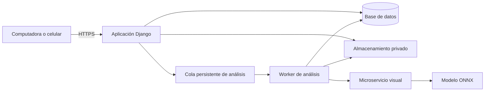

# EVA

## Sistema de análisis visual de sobrantes alimentarios

EVA ayuda a revisar las porciones de alimentos mediante fotografías del plato servido y de su retorno. Integra la captura, el análisis visual, la revisión de Cocina y el seguimiento histórico para apoyar decisiones sobre las cantidades y preparaciones del menú.

Cada servicio conserva la relación entre bandeja, plato, porción, fotografías y contexto. Administración consulta los indicadores, revisa recomendaciones y registra ajustes para comparar sus resultados antes de mantener un cambio. Las decisiones sobre las porciones requieren intervención humana.

Proyecto de Construcción de Software de Ingeniería de Software, Universidad Estatal de Milagro (UNEMI).

## Recorrido del sistema

1. **Identificar la bandeja:** buscar su número o escanear su etiqueta QR.
2. **Registrar el servido:** seleccionar plato, porción y contexto del servicio.
3. **Guardar la primera fotografía:** usar la cámara o seleccionar un archivo y confirmar las condiciones de captura.
4. **Identificar el retorno:** comprobar que corresponde a la misma bandeja y servicio.
5. **Guardar la segunda fotografía:** completar el par y liberar la bandeja.
6. **Solicitar el análisis:** procesar las fotografías en segundo plano y obtener los hallazgos por componente.
7. **Revisar en Cocina:** contrastar fotografías, máscaras y resultados, dejando una decisión y su motivo.
8. **Consultar el histórico:** revisar la evolución, la cobertura y los sobrantes de grupos compatibles.
9. **Decidir sobre las recomendaciones:** aceptar, descartar o mantener en observación una sugerencia.
10. **Probar y comparar:** registrar un ajuste y contrastar el periodo anterior con el periodo durante el cambio.

## Funciones principales

| Módulo | Funciones |
| --- | --- |
| Acceso e Inicio | Autenticación, navegación y tareas disponibles según el rol. |
| Catálogo | Platos, componentes y tipos de porción, con activación y desactivación. |
| Bandejas y servicios | Etiquetas QR, asignaciones, búsqueda, anulación y sustitución de etiquetas con motivo e historial. |
| Captura | Fotografías de servido y retorno, cámara, vista previa y vinculación temporal entre computadora y celular. |
| Análisis visual | Solicitudes e intentos, procesamiento en segundo plano, segmentación por componente y máscaras privadas. |
| Revisión de Cocina | Revisión de evidencia, decisiones justificadas e historial de cambios. |
| Histórico e indicadores | Filtros, evolución semanal, sobrante visual medio, cobertura, perfiles por componente y porción, y comparación de periodos. |
| Percepción | Registro opcional de la opinión del comensal sobre la porción. |
| Recomendaciones | Evaluación de evidencia, sugerencias, decisiones y seguimiento de ajustes mediante pruebas controladas. |

El contexto incluye establecimiento, sede, modalidad, lote de preparación y franja horaria. Las fechas y horas de las fotografías se registran automáticamente al guardarlas. Las instantáneas de composición y contexto conservan la trazabilidad histórica del servicio.

## Roles

| Rol | Responsabilidad |
| --- | --- |
| **Registro** | Registrar servicios y fotografías del servido y retorno. |
| **Cocina** | Solicitar y consultar análisis, revisar fotografías y resultados. |
| **Administración** | Gestionar catálogo y bandejas, consultar indicadores, decidir sobre recomendaciones y evaluar ajustes. |

Los permisos de uso son independientes de las tareas de desarrollo. Una cuenta puede pertenecer a varios grupos; para comprobar restricciones se deben utilizar cuentas de un solo rol. El acceso técnico de Django Admin es independiente de la navegación habitual de EVA.

## Arquitectura



- **Aplicación web:** Django, plantillas HTML, CSS y JavaScript. Las consultas de estado usan respuestas JSON de Django.
- **Persistencia:** SQLite como base predeterminada, con modelos, migraciones y operaciones de dominio mediante el ORM.
- **Archivos:** adaptadores de almacenamiento local privado y Amazon S3. Django controla el acceso a fotografías y máscaras.
- **Procesamiento:** cola de intentos almacenada en la base y un worker independiente de las solicitudes web.
- **Motor visual:** microservicio HTTP interno autenticado que recibe el par de fotografías y devuelve máscaras, áreas y metadatos por componente.
- **Despliegue:** aplicación y procesos en AWS EC2, acceso web mediante HTTPS y almacenamiento privado en S3 cuando se configura ese backend. Las unidades del motor y del worker están en `ops/analisis/`.

S3 almacena archivos; no sustituye la base de datos ni ejecuta la aplicación o el modelo.

## Tecnologías

| Tecnología | Uso |
| --- | --- |
| Python y Django | Aplicación, autenticación, permisos, formularios, ORM y reglas del sistema. |
| HTML, CSS y JavaScript | Interfaz adaptable, cámara, interacción y consulta de estados. |
| Pillow | Validación, orientación y recodificación de fotografías sin metadatos. |
| qrcode y jsQR | Generación y lectura de etiquetas QR. |
| YOLO / Ultralytics | Modelo de segmentación y herramientas de entrenamiento y exportación. |
| ONNX Runtime | Ejecución del modelo exportado en CPU. |
| OpenCV y NumPy | Preprocesamiento y operaciones de inferencia. |
| boto3 | Acceso a Amazon S3 mediante las credenciales o el rol del entorno. |
| Gunicorn | Ejecución WSGI de los procesos configurados para Linux. |

## Análisis visual y criterios de aceptación

El modelo está entrenado para siete componentes: **arroz, pollo, carne, menestra, ensalada, yuca y pescado**. El catálogo es editable; añadir un componente no entrena al modelo para reconocerlo.

EVA distingue la detección del alimento de la validez de su comparación. Encontrar un componente en ambas fotos no demuestra por sí solo que las áreas sean comparables. Para aceptar un resultado se revisan las áreas, la confianza, el protocolo, la versión de los criterios y la comparabilidad del par.

- El predictor ONNX filtra mediante `score > 0.80`. Esa puntuación no equivale a precisión del sistema.
- El sobrante visual se calcula como `100 × área residual / área inicial`, cuando se cumplen los criterios de aceptación.
- El resultado expresa una relación de **áreas visibles**, no gramos, volumen ni cantidad consumida.
- Una detección ausente o un resultado no concluyente no equivalen a cero sobrantes.
- Los componentes no concluyentes quedan excluidos de los indicadores que requieren evidencia apta.
- Los píxeles compartidos por máscaras se retiran de los componentes afectados; no se asignan arbitrariamente a un alimento.
- Los resultados superiores al 100 % no se recortan para aparentar una comparación válida.
- El reconocimiento depende de la imagen, la preparación y las condiciones de captura; no se garantiza para cualquier fotografía.

La configuración base mantiene la comparabilidad sin aprobar y los criterios de aceptación e histórico pendientes de configuración. Conectar los pesos no habilita automáticamente porcentajes válidos ni recomendaciones. Los criterios deben definirse y validarse para el contexto de uso.

## Privacidad, integridad y procesamiento

- Fotografías JPEG o PNG, hasta **10 MiB** y **20 millones de píxeles**.
- Validación del contenido del archivo y recodificación para retirar metadatos. Esto no certifica que la imagen contenga comida.
- Fotografías y máscaras fuera de los archivos estáticos y sujetas a permisos.
- Enlaces de captura temporales, autenticación y protección CSRF.
- Conservación de autoría, fechas, versiones y decisiones humanas.
- Restricciones y actualizaciones condicionales para evitar duplicados y detectar conflictos de versión.
- Solicitudes repetidas del mismo par, modelo y configuración reutilizan el análisis existente.
- Presupuesto de **30 segundos por intento** desde que lo reclama el worker; la espera en cola es independiente.
- Reintentos para intentos fallidos o con tiempo agotado, conservando el historial.
- Limpieza y retención de fotografías y artefactos mediante comandos y unidades de mantenimiento.

## Estructura del repositorio

```text
apps/
  catalogo/          Catálogo, acceso y permisos
  captura/           Servicios, bandejas, fotografías y almacenamiento
  analisis/          Intentos, worker, integración del motor y revisión
  historico/         Consultas, indicadores, comparación y percepción
  recomendaciones/  Evaluaciones, decisiones y pruebas controladas
config/             Configuración Django y rutas
visual_service/     Inferencia, servidor del motor y herramientas del modelo
templates/          Plantillas de la aplicación
static/             Estilos, scripts, iconos y recursos gráficos
ops/                Configuración y herramientas de operación
tests/frontend/     Pruebas JavaScript
docs/               Documentación técnica y de uso
```

## Instalación y ejecución local

Requisitos: Python 3.13, Git y un entorno virtual. Node.js es necesario para las pruebas JavaScript.

```powershell
git clone https://github.com/Sshadowcitoo/EVA.git
cd EVA
py -m venv .venv
.\.venv\Scripts\python.exe -m pip install -r requirements.txt
.\.venv\Scripts\python.exe manage.py migrate
.\.venv\Scripts\python.exe manage.py configurar_roles
.\.venv\Scripts\python.exe manage.py createsuperuser
.\.venv\Scripts\python.exe manage.py check
.\.venv\Scripts\python.exe manage.py runserver
```

Abre `http://127.0.0.1:8000/`. Desde Django Admin se pueden crear las cuentas y asignar los grupos **Registro**, **Cocina** y **Administración**. Configura el catálogo antes de registrar servicios. `configurar_roles` sincroniza permisos; no crea usuarios ni asigna membresías. El repositorio no incluye contraseñas operativas.

No es necesario activar el entorno virtual ni cambiar políticas globales de PowerShell. En una instalación existente, conserva los datos y cambios locales antes de actualizar; no recrees el proyecto.

### Configuración del almacenamiento y el motor

Consulta `.env.example` para conocer las variables del proceso. Django no carga ese archivo automáticamente; configura las variables en el entorno o gestor de servicios autorizado.

| Variables | Función |
| --- | --- |
| `EVA_STORAGE_BACKEND`, `EVA_CAPTURE_PRIVATE_ROOT` | Seleccionar almacenamiento y raíz privada local. |
| `EVA_S3_BUCKET`, `EVA_S3_REGION`, `EVA_S3_PREFIX` | Configurar el bucket y el prefijo privado de S3. |
| `EVA_CAPTURE_BASE_URL` | Origen HTTPS accesible desde computadora y teléfono. |
| `EVA_VISUAL_ENDPOINT`, `EVA_VISUAL_TOKEN` | Conexión autenticada con el microservicio interno. |
| `EVA_VISUAL_PESOS`, `EVA_VISUAL_VERSION_MODELO` | Ruta privada y versión verificable de los pesos del motor. |

El motor usa dependencias adicionales declaradas en `visual_service/requirements-onnx.txt` y, para el servidor Linux, en `visual_service/requirements.txt`. Los pesos no se descargan automáticamente ni se incluyen en Git. La configuración del motor comprueba que su versión coincida con el hash del archivo.

Una vez configurado el motor y sus dependencias, la cola se procesa en otro proceso:

```powershell
.\.venv\Scripts\python.exe manage.py procesar_analisis
```

Sin configuración válida, el worker no consume pendientes. No publiques el servidor de desarrollo de Django como servicio de producción. Integrar cambios en GitHub tampoco actualiza automáticamente el servidor.

## Verificación

En un entorno de desarrollo preparado:

```powershell
.\.venv\Scripts\python.exe manage.py check
.\.venv\Scripts\python.exe manage.py test --noinput
.\.venv\Scripts\python.exe manage.py makemigrations --check --dry-run
node --test tests/frontend/*.test.cjs
git diff --check
```

Las pruebas de aplicación verifican reglas, permisos, formularios, persistencia e integración. No sustituyen la evaluación independiente del modelo, la comprobación física de cámara y QR ni las pruebas del almacenamiento desplegado. Algunas verificaciones de paridad necesitan pesos y archivos privados adicionales.

## Documentación

- [Documentación del software](docs/documentacion_software.md).
- [Manual de usuario](docs/manual_usuario.md).
- [Características técnicas](docs/caracteristicas_tecnicas.md).
- [Administración y almacenamiento S3](docs/administracion_y_s3.md).
- [Cliente del motor, worker y evidencia privada](docs/entrega_lino_bloque_4.md).
- [Revisión de Cocina](docs/entrega_lino_bloque_5.md).

Los documentos de entregas y verificaciones fechadas conservan el historial de desarrollo. Sus cifras y estados corresponden a la revisión indicada en cada documento.

## Contribución

Trabaja en una rama y abre un Pull Request con el cambio, su alcance y la verificación realizada. La integración debe respetar dependencias entre módulos y comprobar los recorridos afectados.

No subas credenciales, archivos `.env`, bases de datos, entornos virtuales, fotografías de usuarios ni pesos privados del modelo. Las migraciones y los recursos propios de la interfaz sí se versionan.
